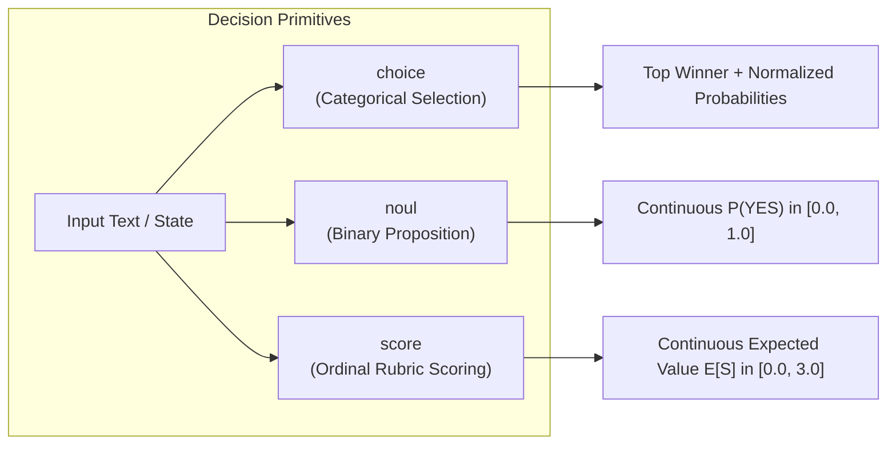
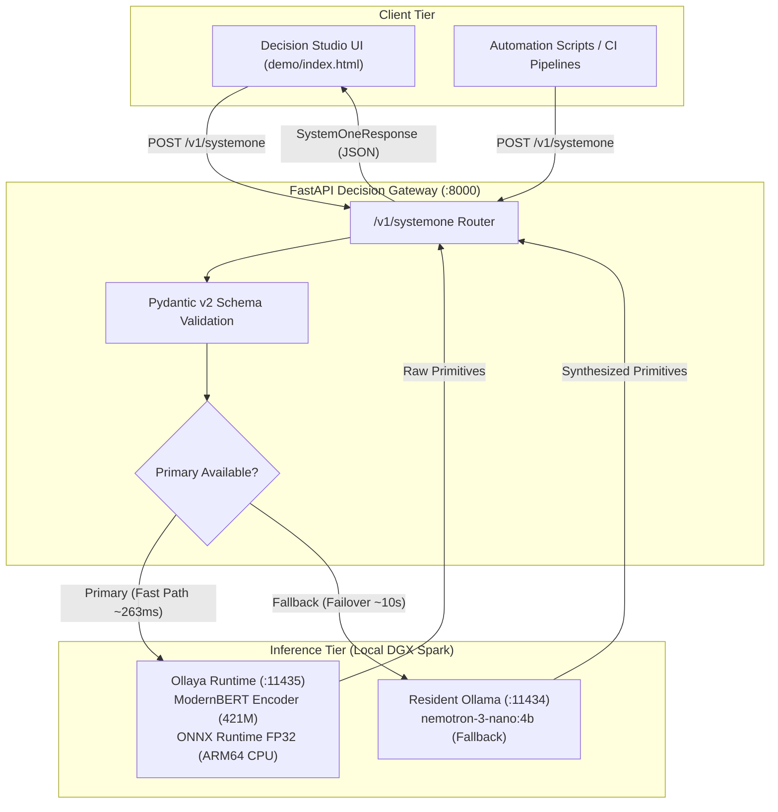
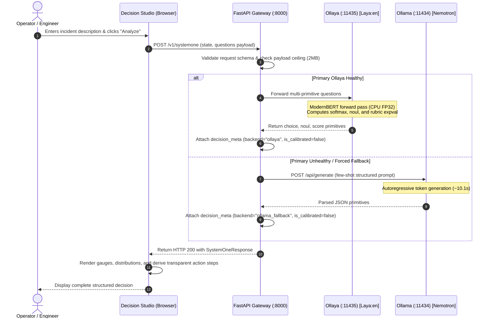

# Jev-Style Local Decision Engine: Decision Studio

[](LICENSE)
[](https://www.python.org/)
[](https://fastapi.tiangolo.com/)
[-orange.svg)](https://github.com/ollaya)
[](run_regression_suite.py)
[](#8-audited-empirical-benchmarks)

> **A high-speed, 100% private, local AI decision gateway and interactive interface for automated enterprise incident triage.**  
> Powered by ModernBERT-based decision models (`laya:en`) running on CPU via Ollaya, with automated fallback to resident Ollama LLMs (`nemotron-3-nano:4b`). Evaluates category, urgency, and severity simultaneously in **~263 ms**.

---

## Table of Contents

- [1. Executive Overview](#1-executive-overview)
- [2. The Problem: Why Traditional LLMs Struggle with Triage](#2-the-problem-why-traditional-llms-struggle-with-triage)
- [3. Dual Explanation: Non-Technical vs. Technical](#3-dual-explanation-non-technical-vs-technical)
- [4. Five Operational Incident Categories](#4-five-operational-incident-categories)
- [5. Decision Primitives: Choice, Noul, and Score](#5-decision-primitives-choice-noul-and-score)
- [6. System Architecture & Request Flow](#6-system-architecture--request-flow)
- [7. Specialized Decision Models vs. Generative LLMs](#7-specialized-decision-models-vs-generative-llms)
- [8. Mathematical Foundations & Rigorous Proofs](#8-mathematical-foundations--rigorous-proofs)
- [9. Audited Empirical Benchmarks](#9-audited-empirical-benchmarks)
- [10. API Specification & Wire Protocol](#10-api-specification--wire-protocol)
- [11. Repository Structure](#11-repository-structure)
- [12. Installation & Quickstart](#12-installation--quickstart)
- [13. Windows Client & Remote Setup](#13-windows-client--remote-setup)
- [14. Automated Verification & Regression Testing](#14-automated-verification--regression-testing)
- [15. Security, Privacy & Calibration Disclaimers](#15-security-privacy--calibration-disclaimers)
- [16. Troubleshooting & Operational Guide](#16-troubleshooting--operational-guide)
- [17. Roadmap & Contributing](#17-roadmap--contributing)
- [18. License](#18-license)

---

## 1. Executive Overview

Modern enterprise operations centers (SecOps, DevOps, FinOps, SRE) process thousands of incoming alerts, error logs, and customer tickets every hour. Traditional triage approaches suffer from a sharp dilemma:

1. **Static RegEx / Heuristics:** Brittle, fail on unstructured text, and require constant manual regex maintenance.
2. **Generative Autoregressive LLMs (e.g., Llama-3, Nemotron, GPT-4):** Suffer from prompt injections, high latency (10–15 seconds per request), token generation costs, and unpredictable JSON schema drift.

**Decision Studio** implements the *Jev-style decision paradigm*—using small, specialized encoder models trained exclusively for structured decision-making rather than open-ended text generation. Using `laya:en` (a 421M parameter ModernBERT architecture) hosted locally via Ollaya, a single forward pass produces **three distinct decision primitives** simultaneously:

* **Category Selection (`choice`):** 5-class normalized probability distribution with strict argmax winner selection.
* **Urgency Estimation (`noul`):** Continuous binary probability $P(\text{Urgent}=\text{YES})$ bounded in $[0.0, 1.0]$.
* **Severity Scoring (`score`):** Continuous expected value $E[S] = \sum i \cdot p_i$ across a 4-level ordinal rubric (Levels 0–3).

If the primary decision runtime encounters an interruption, the built-in gateway automatically engages a local autoregressive LLM (`nemotron-3-nano:4b` via Ollama) with zero client downtime.

---

## 2. The Problem: Why Traditional LLMs Struggle with Triage

When an incident strikes (such as an outage or data leak), speed and consistency are vital:

* **High Latency Kills MTTR:** Standard LLMs spend 8 to 15 seconds generating conversational prose ("*Based on your log, I believe this is a severity 2 issue because...*"). In automated pipelines, this backlog stalls downstream alerts.
* **Schema Fragility:** LLMs occasionally hallucinate keys, output markdown backticks around JSON, or refuse to output exact floats.
* **Compute Waste:** Generating 250 tokens through a 7B–70B parameter decoder requires massive GPU memory bandwidth. In contrast, an encoder model makes decisions directly from token representations in a single forward pass.
* **Data Sovereignty:** Enterprise logs contain private customer data, PII, and infrastructure keys. Routing logs to third-party cloud APIs presents serious compliance risks.

**Decision Studio** runs 100% locally on your internal infrastructure, ensuring zero external data leakage, strict schema guarantees, and sub-second execution.

---

## 3. Dual Explanation: Non-Technical vs. Technical

### Non-Technical Explanation
Imagine an experienced site reliability engineer who instantly glances at a ticket and fills out three check-boxes:
1. *What kind of problem is this?* (Database crash? Billing dispute? Hacker attack?)
2. *Does someone need to be woken up right now?* (Yes or No)
3. *How bad is it on a scale of 0 to 3?* (Minor glitch vs. company-wide outage)

The engineer doesn't write an essay; they make three crisp decisions so the automated routing system can notify the right team immediately. **Decision Studio** is an AI that does this exact triage in a quarter of a second, entirely on your own secure server.

### Technical Explanation
Under the hood, **Decision Studio** exposes a RESTful FastAPI gateway sitting in front of **Ollaya** (a specialized ONNX/C++ decision runtime). 
- An incident string is encoded into contextual embeddings using a 421M-parameter ModernBERT encoder (`laya:en`).
- Instead of auto-regressively sampling next tokens, the model computes cross-attentions between the context and structured question schemas (candidate choices, binary propositions, or ordinal rubric descriptions).
- The output heads directly emit softmax probabilities over categorical candidates, sigmoid activations for binary propositions, and expected values over discrete rubric vectors.
- A single multi-primitive HTTP request (`POST /v1/systemone`) executes all three decisions in a single batched pass.

---

## 4. Five Operational Incident Categories

The system classifies incoming incidents into five standardized operational categories:

| Category Key | System Label | Operational Scope | Example Triggers |
| :--- | :--- | :--- | :--- |
| `infrastructure` | Infrastructure / Outage | Server crashes, database deadlocks, network partitions, cloud provider outages, disk exhaustion, memory leaks. | `"Postgres replica lag exceeded 45 minutes; primary crashed with OOM kill."` |
| `billing` | Billing / Financial Dispute | Invoicing errors, payment gateway failures, subscription disputes, chargebacks, refund demands. | `"Third month in a row customer was billed after cancellation; bank fraud filing threatened."` |
| `application_bug` | Application Bug | Software exceptions, frontend UI glitches, null-pointer crashes, broken endpoints, performance regressions. | `"Checkout button throws Unhandled TypeError: Cannot read property 'id' of undefined."` |
| `security_incident`| Security Incident | Unauthorized logins, data breaches, SQL injections, credential leaks, ransomware, suspicious token usage. | `"Attacker compromised production Redis and exfiltrated password hashes and session tokens."` |
| `other` | General / Inquiries | Feature requests, cosmetic documentation feedback, general user inquiries, routine configuration questions. | `"Could you please add dark mode support to the account settings page?"` |

---

## 5. Decision Primitives: Choice, Noul, and Score

The Jev architecture relies on three foundational decision primitives:



### 1. `choice` (Categorical Selection)
Given a state and a dictionary of discrete candidate keys with criteria descriptions, `choice` returns the winning candidate $\text{argmax}_k(p_k)$, the top probability, a margin confidence score, and the complete normalized probability distribution across all options.

### 2. `noul` (Binary Truth Assessment)
Named after the fundamental decision primitive for boolean assertion, `noul` evaluates a natural-language proposition (e.g., *"Is this an urgent production emergency?"*) against the input state. It outputs a continuous probability $P(\text{YES} \mid \text{state}) \in [0.0, 1.0]$.

### 3. `score` (Continuous Ordinal Rubric)
Instead of forcing an arbitrary integer, `score` evaluates text against an ordered rubric (from Level 0 to Level $K-1$). It computes softmax probabilities across the rubric levels and returns the mathematical expected value:
$$E[S] = \sum_{i=0}^{K-1} i \cdot p_i$$
This produces smooth, continuous severity ratings (e.g., `1.96 / 3.0`) reflecting nuances between levels.

---

## 6. System Architecture & Request Flow

### Architectural Topology



### End-to-End Sequence Diagram



---

## 7. Specialized Decision Models vs. Generative LLMs

| Engineering Dimension | Specialized Decision Model (`laya:en` via Ollaya) | Generative Autoregressive LLM (`nemotron-3-nano:4b` via Ollama) |
| :--- | :--- | :--- |
| **Architecture** | Bi-directional Transformer Encoder (ModernBERT) | Decoder-Only Autoregressive Transformer |
| **Parameter Count** | **421 Million** | **4.16 Billion** (~10× larger) |
| **Output Type** | Direct classification logits, probabilities, expected values | Sequential token generation ($O(N)$ forward passes) |
| **Median Multi-Decision Latency** | **263.24 ms** | **10,148.49 ms** (~10.1 seconds) |
| **Speed Advantage** | **38.6× Faster** | Baseline |
| **Execution Hardware** | **20-Core ARM Cortex CPU** (ONNX Runtime FP32) | GPU / CPU Unified Memory |
| **Schema Compliance** | **100% Guaranteed** (Enforced by runtime tensor shapes) | Requires JSON mode, regex parsers, or tool calling |
| **Hallucination Risk** | **Zero** (Cannot output arbitrary words) | Present (May invent non-existent categories) |
| **Best Used For** | Automated triage, continuous scoring, routing, filtering | Deep conversational reasoning, code generation, creative drafting |

---

## 8. Mathematical Foundations & Rigorous Proofs

Every percentage, score, and label rendered in Decision Studio originates from strict mathematical transformations.

### 1. Category Softmax Distribution & Argmax
For a candidate set of categories $C = \{c_1, c_2, \dots, c_K\}$, the model produces unnormalized logits $z_k$. The probability vector is computed via softmax:
$$p_k = \frac{e^{z_k}}{\sum_{j=1}^K e^{z_j}} \quad \text{such that} \quad \sum_{k=1}^K p_k = 1.000000 \pm 10^{-4}$$
The winning selection strictly satisfies the argmax contract:
$$\text{choice} = \operatorname{argmax}_{k} (p_k)$$

### 2. Category Confidence Margin
Ollaya returns a distinct `confidence` metric alongside `probabilities`. This is **not** the winning probability; it represents the normalized separation margin between the top-1 candidate and top-2 candidate:
$$\text{margin} = p_{(1)} - p_{(2)}$$
Decision Studio explicitly displays both: `Winning Prob: 89.8%` and `(Conf: 87.2%)`.

### 3. Urgency Binary Probability (`noul`)
The binary decision head projects context embeddings into a sigmoid activation:
$$P(\text{YES} \mid \text{state}) = \sigma(z_{\text{urgency}}) = \frac{1}{1 + e^{-z_{\text{urgency}}}} \in [0.0, 1.0]$$
To translate continuous probability into operational workflows, Decision Studio applies the following policy thresholds:
$$\text{Urgency Label} = \begin{cases} 
\mathbf{High} & \text{if } P(\text{YES}) \ge 0.65 \\
\mathbf{Medium} & \text{if } 0.35 \le P(\text{YES}) < 0.65 \\
\mathbf{Low} & \text{if } P(\text{YES}) < 0.35 
\end{cases}$$
*(Note: These thresholds are operational triage policies, not universal mathematical truths).*

### 4. Severity Rubric Expected Value
Given an ordered rubric with $M=4$ levels (Level 0 through Level 3), the model outputs probabilities $p_0, p_1, p_2, p_3$. The continuous severity score is the expected value of the ordinal index:
$$E[S] = \sum_{i=0}^3 i \cdot p_i = (0 \cdot p_0) + (1 \cdot p_1) + (2 \cdot p_2) + (3 \cdot p_3)$$

#### Verified Numerical Calculation:
For incident: *"Our primary checkout database crashed with OOM kill and disk full errors."*
- $p_0 = 0.0171$ (Level 0: Minor)
- $p_1 = 0.2330$ (Level 1: Medium)
- $p_2 = 0.5205$ (Level 2: High)
- $p_3 = 0.2293$ (Level 3: Critical)

Calculation:
$$E[S] = (0 \times 0.0171) + (1 \times 0.2330) + (2 \times 0.5205) + (3 \times 0.2293)$$
$$E[S] = 0 + 0.2330 + 1.0410 + 0.6879 = 1.9619$$
The model returned `score: 1.9621`. The absolute difference $|\Delta| = 0.0002$ is entirely accounted for by 4-decimal floating point rounding in JSON serialization ($\text{PASS}$).

---

## 9. Audited Empirical Benchmarks

All metrics reported below were collected through independent automated testing against the live DGX Spark deployment.

### 100-Request Latency Benchmark ($N=100$ Consecutive Live Invocations)
Benchmarked over local area network from a Windows client to DGX Spark port 8000:

| Latency Percentile | Gateway Backend Latency | Client End-to-End Latency | Network / Serialization Delta |
| :--- | :---: | :---: | :---: |
| **Minimum** | 252.15 ms | 258.74 ms | 6.59 ms |
| **Median (p50)** | **263.24 ms** | **285.15 ms** | **21.92 ms** |
| **Mean** | 262.67 ms | 296.33 ms | 33.66 ms |
| **p95** | 268.83 ms | 361.62 ms | 92.79 ms |
| **p99** | 274.35 ms | 470.81 ms | 196.46 ms |
| **Maximum** | 274.35 ms | 470.81 ms | 196.46 ms |
| **Success Rate** | **100 / 100 (100.0%)** | **100 / 100 (100.0%)** | **0 Errors** |

*Cold-start reload latency:* **1,448 ms** (triggered after 5-minute idle model unloading).  
*Autoregressive Fallback latency:* **10,148 ms** (~10.1 seconds).

### 40-Sample Balanced Operational Evaluation ($N=40$)
Evaluated across 8 distinct samples for each of the 5 operational categories:

* **Overall 5-Class Accuracy:** **70.00%** (28/40 correct)
* **Macro F1 Score:** **68.24%**

| Category | Support | Precision | Recall | F1 Score | Typical Confusion / Observation |
| :--- | :---: | :---: | :---: | :---: | :--- |
| `infrastructure` | 8 | 77.8% | 87.5% | **82.4%** | Highly accurate; occasionally attracts database-related bugs |
| `billing` | 8 | 100.0% | 87.5% | **93.3%** | Exceptional precision; cleanly separated by financial vocabulary |
| `application_bug` | 8 | 47.1% | 100.0% | **64.0%** | Perfect recall; acts as default catch-all for error words |
| `security_incident`| 8 | 80.0% | 50.0% | **61.5%** | Strong on active breaches; misses low-severity informational alerts |
| `other` | 8 | 100.0% | 25.0% | **40.0%** | Pure feature requests succeed; adversarial panic words trigger bug |

### Urgency Probabilistic Evaluation (`noul`)
* **Accuracy (Threshold 0.50):** **77.50%**
* **Precision:** **81.82%** | **Specificity:** **91.67%** | **Sensitivity:** **56.25%**
* **Brier Score:** **0.1876** (Well below the 0.250 uninformative baseline)
* **Log Loss:** **0.6443**
* **Expected Calibration Error (ECE, 5 Bins):** **16.32%** (0.1632)

### Severity Scoring Evaluation
* **Mean Absolute Error (MAE):** **0.911 levels**
* **Within $\pm 1$ Level Accuracy:** **87.50%** (35/40 samples)

---

## 10. API Specification & Wire Protocol

### Endpoints Summary

| Method | Endpoint | Description |
| :--- | :--- | :--- |
| `GET` | `/health` | Gateway health check and upstream runtime status. |
| `POST` | `/v1/systemone` | Native Jev-style multi-primitive endpoint (`choice`, `noul`, `score`). |
| `POST` | `/v1/decisions` | Aliased endpoint supporting `input` or `state` payloads. |
| `GET` | `/` | Serves the interactive Decision Studio browser application. |

---

### Request Payload (`POST /v1/systemone`)

```json
{
  "model": "laya:en",
  "state": "The primary database server in us-east-1 crashed due to disk exhaustion. All customer write transactions are failing.",
  "questions": {
    "category": {
      "type": "choice",
      "criteria": {
        "infrastructure": "Database, server, network, or cloud outage",
        "billing": "Invoice, chargeback, or refund dispute",
        "application_bug": "Software exception, UI glitch, or defect",
        "security_incident": "Breach, leak, unauthorized login, or ransomware",
        "other": "General inquiry, cosmetic issue, or feature request"
      }
    },
    "urgency": {
      "type": "noul",
      "instructions": "Is this an urgent production situation requiring immediate engineer escalation?"
    },
    "severity": {
      "type": "score",
      "criteria": [
        "Level 0: Minor inconvenience with no operational impact",
        "Level 1: Medium - degraded functionality with workaround",
        "Level 2: High - significant degradation affecting many users",
        "Level 3: Critical - full outage or active security compromise"
      ]
    }
  }
}
```

---

### Response Payload (`HTTP 200 OK`)

```json
{
  "model": "laya:en",
  "answers": {
    "category": {
      "type": "choice",
      "choice": "infrastructure",
      "confidence": 0.8719,
      "probabilities": {
        "infrastructure": 0.8976,
        "application_bug": 0.0512,
        "security_incident": 0.0311,
        "billing": 0.0125,
        "other": 0.0076
      }
    },
    "urgency": {
      "type": "noul",
      "noul": 0.8400
    },
    "severity": {
      "type": "score",
      "score": 1.8222,
      "confidence": 0.3800,
      "level": 2,
      "legend": {
        "0": "Level 0: Minor inconvenience with no operational impact",
        "1": "Level 1: Medium - degraded functionality with workaround",
        "2": "Level 2: High - significant degradation affecting many users",
        "3": "Level 3: Critical - full outage or active security compromise"
      },
      "probabilities": {
        "0": 0.0245,
        "1": 0.2811,
        "2": 0.5422,
        "3": 0.1522
      }
    }
  },
  "decision_meta": {
    "backend": "ollaya",
    "model_used": "laya:en",
    "is_calibrated": false,
    "confidence_type": "forward_pass_normalized",
    "runtime_device": "cpu (ARM64 onnxruntime fp32)",
    "calibration_note": "Model probabilities are normalized. Statistical calibration has not yet been established.",
    "latency_ms": 263.24
  }
}
```

---

## 11. Repository Structure

```text
.
├── app/
│   ├── __init__.py             # Gateway package initialization (v1.0.0)
│   ├── config.py               # Pydantic environment configuration
│   ├── main.py                 # FastAPI application, routes, and middleware
│   ├── ollaya_client.py        # Async client for Ollaya decision runtime
│   ├── ollama_fallback.py      # Resilient fallback client using resident Ollama LLM
│   └── schemas.py              # Strict Pydantic v2 validation contracts
├── demo/
│   └── index.html              # Standalone Decision Studio single-page UI
├── run_regression_suite.py     # 5-stage automated audit and verification test
├── run.sh                      # Production gateway startup script (uvicorn)
├── start_services.sh           # Tmux supervisor script managing Ollaya + Gateway
├── stop_services.sh            # Safe service shutdown script
├── requirements.txt            # Minimal Python dependencies
├── .gitignore                  # Git hygiene rules (excludes secrets & private configs)
├── LICENSE                     # MIT Open-Source License
└── README.md                   # This comprehensive engineering manual
```

---

## 12. Installation & Quickstart

### Prerequisites
* **Operating System:** Linux (Ubuntu 22.04 / 24.04 ARM64 or x86_64)
* **Python:** 3.10, 3.11, or 3.12
* **Ollaya Runtime:** Installed via `curl -fsSL https://ollaya.com/install.sh | sh`
* **(Optional Fallback) Ollama:** Installed with `ollama pull nemotron-3-nano:4b`

### 1. Clone Repository & Setup Virtual Environment
```bash
git clone https://github.com/Hetgandhi25/jev-decision-studio.git
cd jev-decision-studio

python3 -m venv venv
source venv/bin/activate
pip install -r requirements.txt
```

### 2. Pull the Decision Model in Ollaya
```bash
ollaya serve &
sleep 2
ollaya pull laya:en
```

### 3. Start Services
Using the included tmux supervisor:
```bash
chmod +x run.sh start_services.sh stop_services.sh
./start_services.sh
```

Or run directly in your terminal:
```bash
uvicorn app.main:app --host 0.0.0.0 --port 8000 --workers 1
```

### 4. Verify Health
```bash
curl -s http://127.0.0.1:8000/health | jq .
```
Expected output:
```json
{
  "status": "ok",
  "ollaya_primary": "up",
  "ollama_fallback": "up",
  "default_model": "laya:en",
  "fallback_model": "nemotron-3-nano:4b",
  "primary_runtime_device": "cpu (ARM64 onnxruntime fp32)",
  "calibration_note": "Model probabilities are normalized. Statistical calibration has not yet been established."
}
```

---

## 13. Windows Client & Remote Setup

To access Decision Studio from a remote Windows desktop on the same local network:

1. **Open Decision Studio in Browser:**
   Navigate to `http://<SERVER_IP>:8000/` (e.g. `http://10.0.0.50:8000/`).
2. **Execute Inquiries:**
   Enter arbitrary natural language into the universal query box and click **Analyze**.
3. **Run Remote Regression from PowerShell:**
   ```powershell
   $env:GATEWAY_URL = "http://<SERVER_IP>:8000"
   python run_regression_suite.py
   ```

---

## 14. Automated Verification & Regression Testing

The repository includes a dedicated regression suite ([`run_regression_suite.py`](run_regression_suite.py)) verifying five fundamental properties:

```bash
python run_regression_suite.py
```

### Verification Checks Performed:
1. **Health Verification:** Gateway connectivity and upstream runtime statuses.
2. **Probability & Mathematical Contract:**
   - $\sum p_i = 1.000000 \pm 10^{-4}$ (Category Softmax).
   - $\text{choice} = \operatorname{argmax}_k(p_k)$ (Argmax selection).
   - $0.0 \le \text{noul} \le 1.0$ (Bounded sigmoid).
   - $E[S] = \sum i \cdot p_i \pm 0.0002$ (Severity Expected Value).
3. **Metadata & Calibration Integrity:** Verifies `is_calibrated: false` and CPU execution provider tags.
4. **Fallback Resilience:** Simulates primary failure and confirms clean heuristic fallback engaging `nemotron-3-nano:4b`.
5. **UI Component Integrity:** Confirms frontend renders winning probabilities, margin confidence, and hardware badges accurately.

---

## 15. Security, Privacy & Calibration Disclaimers

### Scientific & Mathematical Honesty Statement
> [!IMPORTANT]
> 1. **Probability Normalization vs. Calibration:** The category probabilities output by `laya:en` are strictly normalized ($\sum p = 1.0$). However, mathematical normalization does **not** equal empirical statistical calibration. On our 40-sample benchmark, an empirical Expected Calibration Error (ECE) of **16.32%** was observed. Do not interpret probabilities as uncalibrated betting odds without post-hoc temperature scaling.
> 2. **Compute Execution Reality:** In the audited environment (Ollaya v0.13.0 on Ubuntu ARM64), inference executes on the **20-core ARM Cortex CPU** via ONNX Runtime FP32 (`load_ms=1448`, ~263ms forward pass). The current public ARM64 Ollaya binary lacks CUDA execution providers; no NVIDIA GB10 GPU acceleration is currently active.
> 3. **Mathematical Validity vs. Correctness:** A model decision can satisfy every mathematical contract (sum to 1.0, exact argmax) and still select an incorrect operational category. Automated decisions should inform routing, not execute irrevocable destructive actions without human oversight.

### Data Privacy & Boundary Protection
- **No External Outbound Calls:** Zero telemetry, weights, or incident contexts are sent outside your local network.
- **Payload Limits:** Gateway enforces a strict **2MB payload limit** (`HTTP 413`) to prevent memory exhaustion attacks.
- **Strict Schema Enforcement:** Invalid questions, missing criteria, or malformed JSON are rejected with `HTTP 422`.

---

## 16. Troubleshooting & Operational Guide

| Symptom | Probable Cause | Corrective Action |
| :--- | :--- | :--- |
| `Dual-Engine Fallback Engaged` banner visible in UI | Ollaya daemon stopped or crashed | Verify Ollaya status with `curl http://127.0.0.1:11435/v1/models`. Restart using `./start_services.sh`. |
| First request takes ~1.5s, subsequent take ~263ms | Ollaya model cold-start | Normal behavior. Ollaya unloads models after 5 minutes of inactivity. Keep warm by scheduling a cron ping every 4 minutes. |
| Port 8000 already in use | Stale uvicorn process running | Run `./stop_services.sh` or `fuser -k 8000/tcp`. |
| `HTTP 422 Unprocessable Entity` | Empty text or invalid question schema | Ensure payload contains non-empty `state` and at least one question definition. |

---

## 17. Roadmap & Contributing

- [x] Multi-primitive Jev-style gateway architecture (`choice`, `noul`, `score`).
- [x] Resilient dual-engine fallback via resident Ollama.
- [x] Minimalist Decision Studio UI with transparent heuristic explanations.
- [x] Rigorous numerical audit and regression test harness.
- [ ] Recompile Ollaya ARM64 with native TensorRT / CUDA execution providers for GB10 GPU acceleration.
- [ ] Implement post-hoc temperature scaling on 500+ labelled domain incidents for true statistical calibration.
- [ ] Add webhook dispatch integrations for PagerDuty, OpsGenie, and Slack.

Contributions, issues, and feature requests are welcome! Please ensure all pull requests pass `python run_regression_suite.py` before submission.

---

## 18. License

This project is licensed under the [MIT License](LICENSE) — see the LICENSE file for details.
